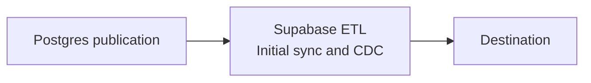

<p align="center">
  
</p>

<h1 align="center">Supabase ETL</h1>

<p align="center">
  <strong>Open-source Postgres replication</strong><br>
  Copy existing rows and stream changes to your warehouse or lakehouse.
</p>

<p align="center">
  <a href="#quickstart">Quickstart</a> ·
  <a href="https://supabase.github.io/etl/">Docs</a> ·
  <a href="crates/etl-examples/README.md">Rust&nbsp;examples</a>
</p>

<p align="center">
  <a href="https://github.com/supabase/etl/actions/workflows/ci.yml"></a>
  <a href="https://coveralls.io/github/supabase/etl?branch=main"></a>
</p>

Run the standalone replicator or embed the Rust library.
[Supabase Pipelines](https://supabase.com/docs/guides/database/replication/pipelines)
is the managed version, available in the Supabase Dashboard.

> [!NOTE]
> Supabase ETL is under active development. We are holding the first versioned
> release while breaking changes to APIs and setup are still frequent.

## Quickstart

Run a pipeline from PostgreSQL 19 to ClickHouse on your machine. Install the
tools in the [development guide](DEVELOPMENT.md#start-here) and start Docker.

```bash
git clone https://github.com/supabase/etl.git
cd etl
cargo x init
cargo x setup replicator
cargo x seed
cargo x run replicator
```

Leave the replicator running. In another terminal, query ClickHouse. After the
initial copy, the query returns `1` and `User 1`.

```bash
curl -fsS -u etl:etl http://localhost:8123/ \
  --data-binary 'SELECT id, name FROM public_users__current WHERE id = 1'
```

Update that row in Postgres, then run the ClickHouse query again. Once the
change replicates, the name is `ETL demo`.

```bash
PGPASSWORD=postgres psql -h localhost -p 5430 -U postgres -d etl_testdata \
  -c "update users set name = 'ETL demo' where id = 1"
```

Stop the replicator with Ctrl+C. To connect your own source or destination,
use the [standalone replicator guide](https://supabase.github.io/etl/guides/standalone-replicator/).

## How it works



1. **Initial sync** copies the selected rows from a consistent snapshot and
   catches up changes committed during the copy.
2. **Ongoing replication** decodes changes from the Postgres write-ahead log
   (WAL) and sends them to the destination.

ETL runs in one Rust process and writes directly to the destination. It
buffers pending changes in memory and applies backpressure by slowing reads
from Postgres. There is no local disk spool to provision or manage. Postgres
WAL supplies the replay history, and a durable state store saves checkpoints
so ETL can resume after a restart. Delivery is at least once.
[Architecture](https://supabase.github.io/etl/explanation/architecture/)

### Operational limits

- **WAL retention.** A long initial copy or a slow or unavailable destination
  can make replication slots retain more WAL on the source. With a retention
  limit, Postgres can remove required WAL and invalidate a slot. A lost
  table-sync slot requires a fresh copy of that table. Losing the apply slot
  can require resyncing the pipeline.
  [WAL buildup and slot recovery](https://supabase.github.io/etl/guides/configure-postgres/#wal-buildup-and-disk-usage)
- **Schema changes.** Schema-change handling is in public beta. Some changes
  require a table resync, and queued schema changes can block queries during
  a long initial copy. [Schema changes](https://supabase.github.io/etl/explanation/schema-changes/)

## Source and destinations

ETL supports PostgreSQL 14 through 19. The source needs logical WAL, a
publication, and a login role with replication and read permissions.
PostgreSQL 15 adds publication column lists and row filters. Logical decoding
from a physical standby requires PostgreSQL 16 or newer.
[Configure Postgres](https://supabase.github.io/etl/guides/configure-postgres/)

| Destination | Rust feature |
| --- | --- |
| ClickHouse | `clickhouse` |
| Google BigQuery | `bigquery` |
| DuckLake | `ducklake` |
| Snowflake | `snowflake` |

[Destination requirements and limitations](https://supabase.github.io/etl/reference/destinations/)

## Use ETL in your application

Add the `etl` crate from Git, with `rev` set to the commit you tested.
The library exposes traits for custom destinations and state stores.

```toml
[dependencies]
etl = { git = "https://github.com/supabase/etl", rev = "<commit-sha>" }

# Cargo applies driver patches from the application workspace root.
[patch.crates-io]
sqlx-core = { git = "https://github.com/supabase/sqlx", rev = "ed1c63355ad7430f9bfba0f3ea5064d5f03ce2c9" }
sqlx-postgres = { git = "https://github.com/supabase/sqlx", rev = "ed1c63355ad7430f9bfba0f3ea5064d5f03ce2c9" }
```

[Build your first Rust pipeline](https://supabase.github.io/etl/guides/first-pipeline/) · [Implement a destination or store](https://supabase.github.io/etl/guides/custom-implementations/)

## Container images

The public replicator image is available for Linux AMD64 and ARM64. Set
`IMAGE_TAG` to a published full commit SHA to pin the build.

```bash
docker pull "public.ecr.aws/supabase/etl-replicator:$IMAGE_TAG"
```

The `latest` tag tracks builds from `main`. Supply your pipeline and
destination settings at runtime. [Replicator configuration](https://supabase.github.io/etl/guides/standalone-replicator/#create-the-configuration)

## Performance

Hardbyte tested four HTTP consumers at a target of 200 source changes per
second. ETL ran at commit `d206d66e` with a custom HTTP destination and an
in-memory store. [Benchmark data](https://github.com/hardbyte/postgresql-job-queue-benchmarking/blob/7b2919a0fd668a84efc68500ac94cfbfbd3b7356/results/cdc-sweep-long/REPORT.md#fanout_steady)
· [Methodology](https://supabase.github.io/etl/reference/benchmarks/)

| Metric | Supabase ETL | Debezium Server 3.1.3.Final |
| --- | ---: | ---: |
| Median rolling p99 latency of the slowest consumer | 26 ms | 848 ms |
| Summed peak resident memory | 13 MB | 1,629 MB |

## Contributing

Use the [development guide](DEVELOPMENT.md) to set up the workspace and run
tests. Report bugs and discuss new destinations in [GitHub Issues](https://github.com/supabase/etl/issues).
Report security vulnerabilities privately as described in [SECURITY.md](SECURITY.md).

## License

[Apache License 2.0](LICENSE).
